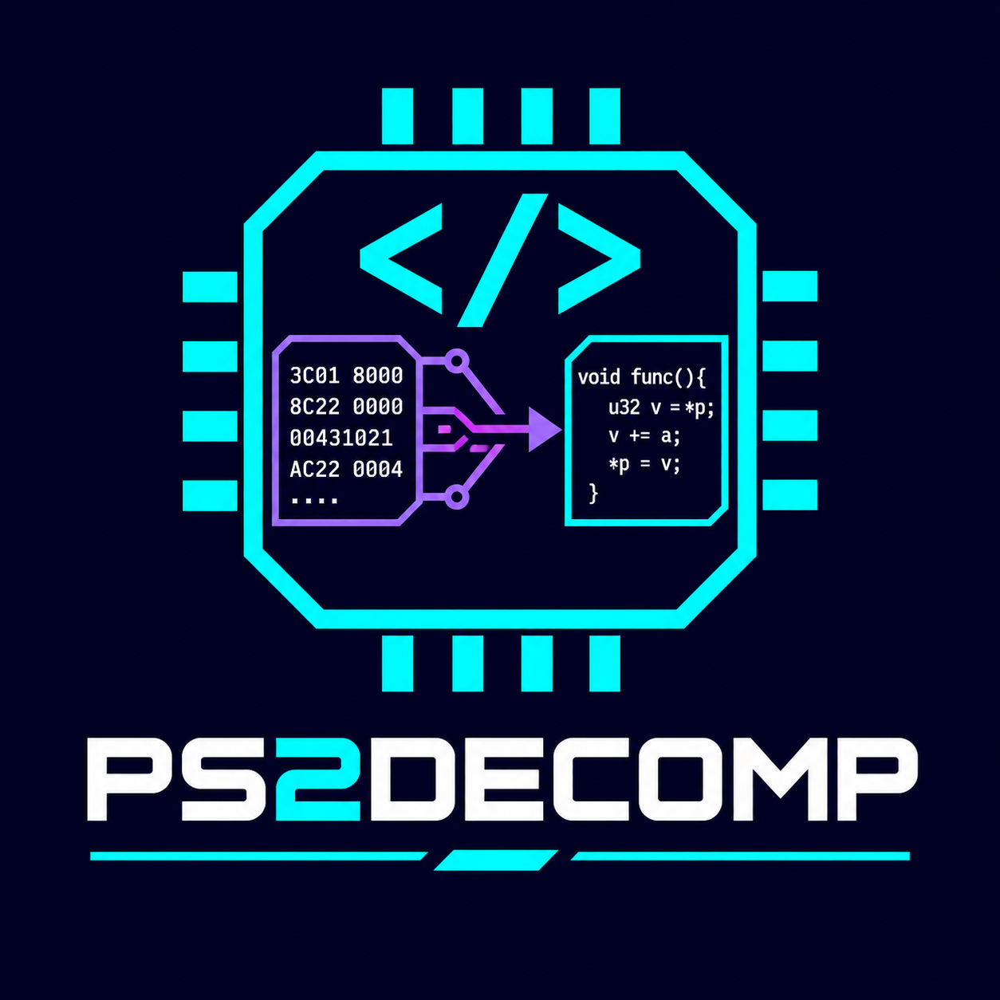

<p align="center">
  
</p>

<h1 align="center">PS2DECOMP</h1>
<p align="center">From PS2 machine code to evidence-backed C.</p>

PS2DECOMP is a local VS Code decompilation workbench for PlayStation 2 projects.
It combines a C editor, native assembly comparison, bounded C variant search,
persistent queues and explicit review handoff. **No AI service is required.**

The interface follows the VS Code display language: German for `de` locales,
English otherwise. Open **Ctrl+Shift+P** and search for **PS2DECOMP**.

**Bring your own game ROM / disc image.** No game ROMs, ISOs, extracted game
executables or game assets are included in this repository, the extension or
GitHub releases. Users must provide their own game image and extract the required
references locally. PS2DECOMP does not download game images or provide ROM links.

## Get started

1. Download the `.vsix` from [Releases](https://github.com/Sumaiter/PS2DECOMP/releases).
2. In VS Code, run **Extensions: Install from VSIX…**, then reload the window.
3. Follow **[einrichtungs.md — game setup guide (English)](einrichtungs.md)**.
4. Open a trusted game workspace containing `ps2decomp.json`. Use
   **PS2DECOMP: Open workbench / select function** or
   **PS2DECOMP: Open automatic decompilation**.

The setup-guide command is available even before a game is configured. Each
workspace owns its game paths and sessions; user-level repository paths cannot
silently attach an unrelated game.

## What is included

- A manual C workbench with assembly, declarations, byte/relocation comparison
  and separate immutable candidate snapshots.
- Automatic rough decompilation through an optional local
  [m2c](https://github.com/matt-kempster/m2c) installation, followed by guarded
  C transformations and compilation with the game's configured toolchain.
- Shared atomic claims, persistent budgets, negative attempt history, source
  and object deduplication, best-candidate retention and explicit handoff.
- A manifest-driven ELF32 little-endian MIPS adapter for new EE projects.
- Existing game integrations in **[`RAC3_PAL`](RAC3_PAL)** and
  **[`RAC4_PAL`](RAC4_PAL)**, with separate compiler, catalogue and coordination
  logic. These require their corresponding prepared game repositories.
- English/German commands, settings and panels, plus an original project logo.

This repository contains the tool, adapter source and synthetic tests. Supply
your own game repository, original references and appropriate toolchain locally.
Adding an ELF alone does not establish function boundaries, ABI or compiler flags.

## Verification comes first

A search score, including 100, is **not an approved decompilation**. Technical
checks are followed by independent review of types, ABI, initial values,
semantics, ownership and function boundaries, plus the game's full build checks.
Unknown relocations and incomplete coordination fail closed.

The generic adapter currently supports ELF32 little-endian MIPS EE objects and
`R_MIPS_32`, `R_MIPS_26`, paired `R_MIPS_HI16`/`R_MIPS_LO16`, and external
`R_MIPS_GPREL16` with evidenced GP. Other relocations, compiler-specific layouts,
IOP/VU code and unusual data ownership need a game adapter and evidence.

## Contribute

Read **[AGENTS.md](AGENTS.md)** and **[CONTRIBUTING.md](CONTRIBUTING.md)**.
Game projects should contribute improvements back through PRs. Shared changes
must work across games; game-specific logic belongs in `GameName_PAL` (or a
separate regional adapter). Do not submit game data or proprietary toolchains.

## Develop and package

Requires Python 3.10+ and VS Code 1.96+. The supplied game adapters currently
target the original Windows toolchains; the generic adapter accepts portable
argument-array compiler wrappers.

```powershell
python -m venv .venv
.\.venv\Scripts\python.exe -m pip install -r requirements.txt
.\.venv\Scripts\python.exe -m unittest discover -s tests -v
node --test tests/*.test.js
python package_local.py
code --extensionDevelopmentPath=. C:/path/to/your/game
```

On Linux/macOS use `.venv/bin/python` for the Python commands. Packaging is
offline and reads its own VSIX metadata; no older RAC extension is required.
See the [VS Code packaging documentation](https://code.visualstudio.com/api/working-with-extensions/publishing-extension)
for the alternative `vsce` workflow.

GPL-3.0-only. See [LICENSE](LICENSE) and [THIRD_PARTY_NOTICES.md](THIRD_PARTY_NOTICES.md).
